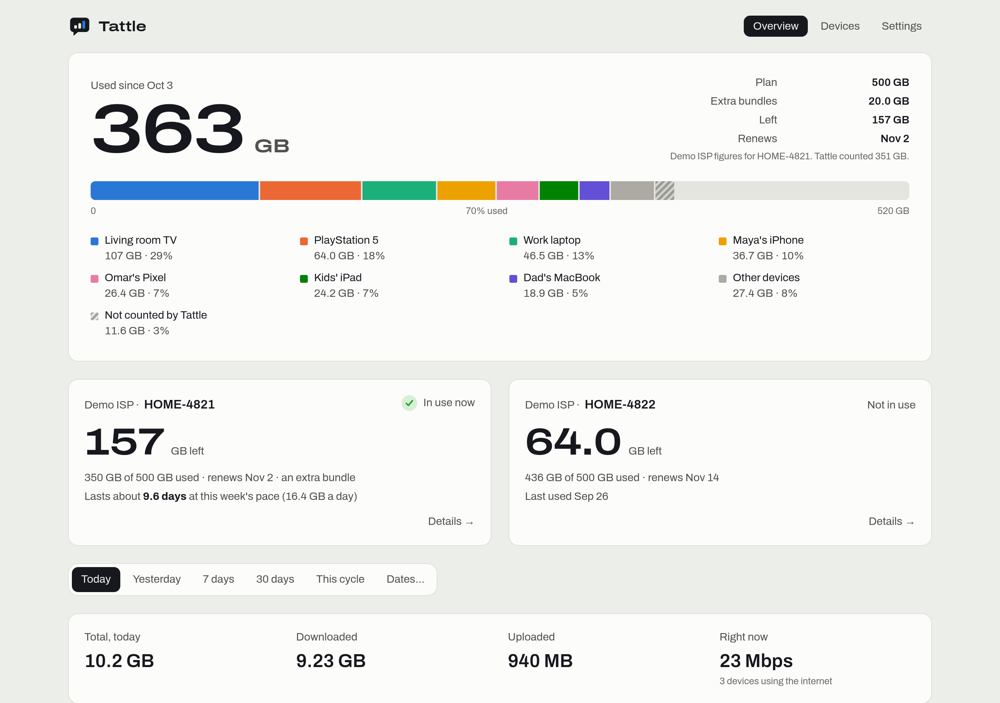
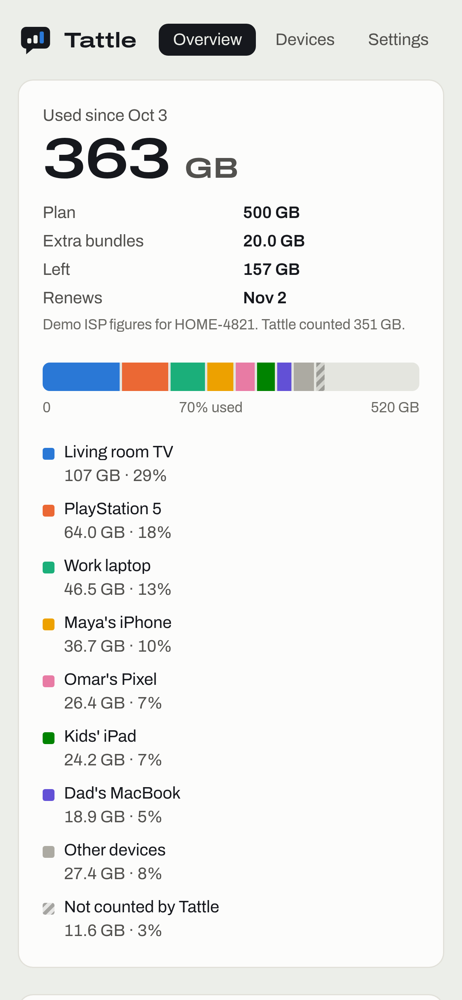
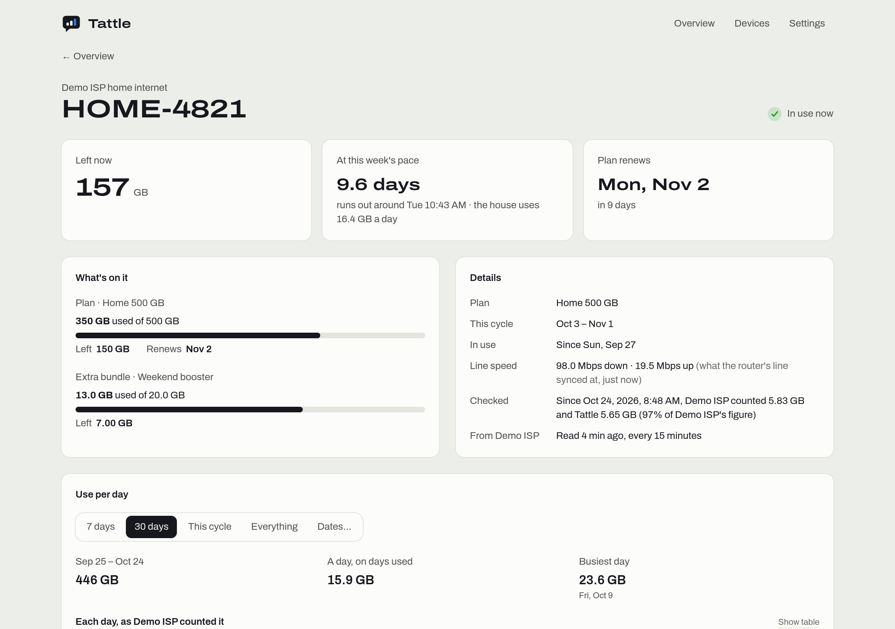
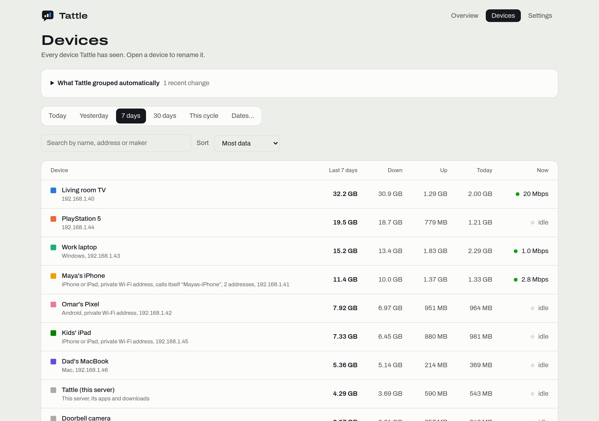
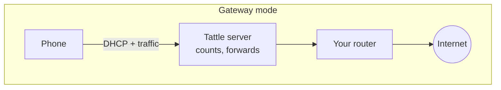
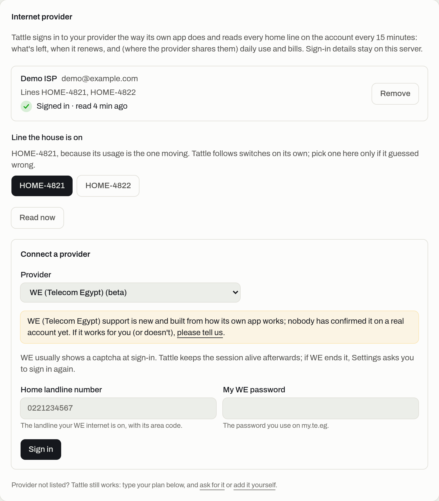
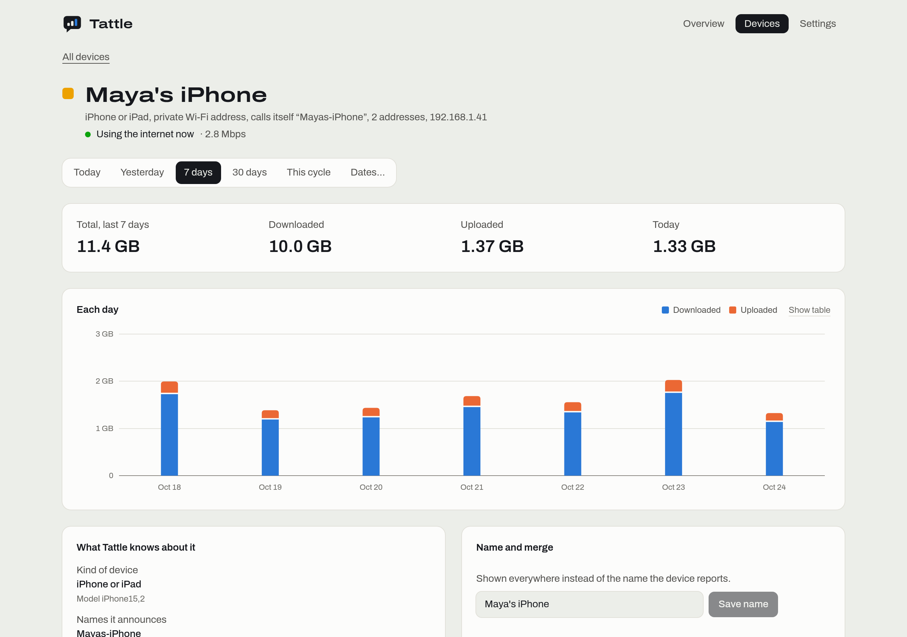

<p align="center">
  
</p>

<h1 align="center">Tattle</h1>

<p align="center">
  <b>Tattle tells you who ate the quota.</b><br/>
  Exact internet use per device for a home line with a data cap, next to your provider's own figures:<br/>
  what's left, how long it lasts at this pace, and when it renews.
</p>

<p align="center">
  <a href="../../releases/latest"></a>
  <a href="../../pkgs/container/tattle"></a>
  
  
  <a href="LICENSE"></a>
</p>

- **Who used what, exactly.** Tattle counts the bytes of every device on your network as they happen: the TV, each phone, the game console, the laptop someone left syncing photos. Counts, not estimates, and never what anyone browsed.
- **Your provider's own numbers, without opening its app.** Tattle signs in to your provider the way its app does and shows what's left, the renewal date, daily use and bills, next to its own count. No "renewal day" to type: the cycle comes from the provider.
- **Runs on an old laptop or a Raspberry Pi.** One command installs it, it works with any router, and you choose how much it does: from just reading your provider's figures to counting every device.

<p align="center">
  <picture>
    <source media="(prefers-color-scheme: dark)" srcset="docs/screenshots/overview-dark.png" />
    
  </picture>
</p>
<p align="center">
  
  
  
</p>
<p align="center"><sub>Screenshots of the built-in demo: a made-up household.</sub></p>

> [!IMPORTANT]
> **e& (Etisalat) Egypt is the provider tested on a real account.** WE, Vodafone Egypt, Aussie Broadband, Telenet/BASE, Ogero, Xfinity and Start.ca are in **beta**: built from how their own apps work, not yet confirmed by someone using them. Have one of them? [Ten minutes of testing](#help-test-it) is the most useful contribution there is. Any other provider works too: type your plan's size and renewal day.

## Try it in 30 seconds

```bash
docker run --rm -p 8090:8090 -e TATTLE_DEMO=1 ghcr.io/khaledsharara/tattle
```

Open <http://localhost:8090>: a made-up household with ten devices and two lines. Nothing on your network is touched.

## What you need

| | |
| --- | --- |
| **An old laptop** *(recommended)* | Any laptop from the last 10–12 years with an Ethernet port (or a USB Ethernet adapter). Its battery doubles as a UPS: when the power blips, the house's internet keeps flowing through it. Install Ubuntu Server or Debian and leave it closed on a shelf next to the router. |
| **A Raspberry Pi 4 or 5** | With **64-bit** Raspberry Pi OS, wired Ethernet, and ideally a USB SSD instead of the SD card. A Pi 4 forwards a few hundred Mbps comfortably. |
| **Any home-lab box** | A mini PC, a NAS or a server that already runs Docker. |

Linux with Docker (the installer can install Docker), 1 GB of RAM, a few hundred MB of disk. Gateway mode needs **wired Ethernet** and a fixed address on the network; the other modes are happy on Wi-Fi.

## Install

```bash
curl -fsSL https://raw.githubusercontent.com/khaledsharara/tattle/main/install.sh | bash
```

The installer checks Docker (and offers to install it), works out your network, asks which [mode](#pick-a-mode) you want, writes `~/tattle/.env` and `docker-compose.yml`, and starts Tattle. In gateway mode it also explains and asks before each change it makes to the server (a fixed address, IP forwarding, firewall openings). It ends with the dashboard's address and a **setup code**.

Then:

1. Open `http://<your server>:8090`, type the setup code, and choose the admin password. Anyone at home can look; changes need the password.
2. **Settings › Internet provider**: connect your provider. Tattle reads it every 15 minutes from then on. Not listed? Type your plan's size and renewal day under **Plan**.
3. Gateway mode: [turn off your router's DHCP](#gateway-mode-step-by-step). Router mode: choose your router under **Settings › Router**.

<details>
<summary>Install by hand instead</summary>

```bash
mkdir -p ~/tattle/data && cd ~/tattle
curl -fsSLO https://raw.githubusercontent.com/khaledsharara/tattle/main/docker-compose.yml
curl -fsSL https://raw.githubusercontent.com/khaledsharara/tattle/main/.env.example -o .env   # then edit it
sudo chown 1000:1000 data
docker compose up -d                       # quota-only and router modes
docker compose --profile gateway up -d     # gateway mode
docker compose logs tattle | grep -i "setup code"
```
</details>

**Update:** `cd ~/tattle && docker compose pull && docker compose up -d` (add `--profile gateway` in gateway mode). Counts and sign-ins live in `~/tattle/data` and survive updates.

## Pick a mode

| | What you get | What changes on your network | Works with |
| --- | --- | --- | --- |
| **Quota only** | Your provider's figures: what's left, renewal, pace, daily use and bills (where the provider shares them) | Nothing | Any router |
| **Router** *(beta)* | Plus traffic per device, read from the router's own counters | Nothing | OpenWrt with nlbwmon, MikroTik RouterOS 7, UniFi ([details](docs/routers/README.md)) |
| **Gateway** | Plus **exact** traffic per device on any router, a phone's private addresses linked into one device, devices behind Wi-Fi extenders told apart | The server hands out the network's addresses and forwards its internet traffic; the router's DHCP is turned off | Any router that lets you turn DHCP off (nearly all) |



In gateway mode the server sits *next to* the router, not between it and the modem: one Ethernet cable, no new hardware. Devices get their address from Tattle with Tattle as their gateway; Tattle counts and forwards each packet to the router. Traffic between devices at home (casting to the TV, file copies) never touches the internet line and isn't counted, because it doesn't use your quota.

### Gateway mode, step by step

1. **Give the server a fixed address.** The installer offers to do it; or reserve its address in the router's DHCP settings *before* turning DHCP off.
2. **Run the installer and choose Gateway.** Tattle starts handing out addresses alongside the router.
3. **Turn off DHCP on your router.** It's usually under *LAN*, *Network* or *DHCP server*. If you have Wi-Fi extenders or mesh points, set their DHCP server to **Off** (not *Auto*).
4. **Turn off IPv6 on the router's LAN** if it has an option for it (or set `TATTLE_FILTER_AAAA=1`). Tattle counts IPv4; over IPv6, devices would go around it.
5. **Reconnect your devices** (Wi-Fi off and on) or wait: leases renew within a few hours. Devices appear under **Devices** as they do, and the health panel turns green.

**To undo:** `cd ~/tattle && docker compose --profile gateway rm -sf gateway && docker compose run --rm gateway off`, then turn the router's DHCP back on. The full guide, including what happens when the server goes down: [docs/gateway-mode.md](docs/gateway-mode.md).

## Connect your provider

| Provider | Country | Status | What Tattle reads | Signing in |
| --- | --- | --- | --- | --- |
| [e& (Etisalat)](docs/providers/eand_eg.md) | Egypt | **Stable** | What's left, renewal, daily use, bills | An SMS code to the line's contract mobile |
| [WE (Telecom Egypt)](docs/providers/we_eg.md) | Egypt | Beta | What's left, renewal | Landline, password and a captcha |
| [Vodafone home internet](docs/providers/vodafone_eg.md) | Egypt | Beta | What's left, renewal | Mobile number and password |
| [Aussie Broadband](docs/providers/aussie_bb.md) | Australia | Beta | Use this cycle, days left | User name and password |
| [Telenet / BASE](docs/providers/telenet_be.md) | Belgium | Beta | Use this cycle, daily use | User name and password |
| [Ogero](docs/providers/ogero_lb.md) | Lebanon | Beta | Quota and consumption | User name and password |
| [Xfinity](docs/providers/xfinity_us.md) | USA | Beta | Monthly use and allowance | Sign in once in your browser |
| [Start.ca](docs/providers/startca.md) | Canada | Beta | Use this month | API key |

Sign-ins stay on your server, and Tattle keeps itself signed in. Several numbers on one account show up from one sign-in.

<p align="center">
  
</p>

**Not listed?** Tattle still works: type your plan's size and renewal day in Settings, and it shows what's left and the pace from its own count. We looked for usable APIs for Orange Egypt (home), Starlink, Cox, TekSavvy, Telstra, e& UAE, du, STC and Zain and found none we could build on; if you know one, [tell us](../../issues/new?template=provider-request.yml), or [add your provider](docs/adding-a-provider.md): it's one Python file.

## Edge cases it handles

**Two lines on one connection.** Some households keep two plans on one connection (two smaller plans can cost less than one big one) and switch by changing the router's internet login. It just works: connect both (one sign-in shows every line on the account) and Tattle follows the line the house is on. It knows which from the router's login when a router adapter can read it, otherwise from which line's usage is moving, and you can always pick it by hand. The quota meter, "This cycle" and the comparisons follow the switch.

**Wi-Fi extenders.** Range extenders like TP-Link's RE series do *MAC-NAT*: on the network, every device behind the extender wears the extender's own hardware address, so it looks like one device. In gateway mode Tattle tells them apart by the DHCP client ID each device sends, which survives MAC-NAT. Two more things extenders get wrong, and how Tattle copes:
- They often lose DHCP replies sent directly to a device, so Tattle always broadcasts its replies.
- Set to *Auto*, an extender starts its own DHCP server when it stops seeing the router's, handing out wrong addresses. Set its DHCP server to **Off**; Tattle checks the network every few minutes and warns if any other DHCP server answers.

Give extenders a fixed address so their admin pages stay where you left them.

**Phones with a private address per Wi-Fi network.** iPhones and Android phones use a different made-up hardware address on each network name, so with separate names for the router and the extenders one phone shows up as several devices. Tattle links them on its own: same DHCP request shape, never online at the same time, and clean hand-overs from one network to the other. If two linked addresses are ever online together it splits them again. Every decision is listed under *Devices › What Tattle grouped automatically*, and you can undo any of them.

<p align="center">
  
</p>

**IPv6.** Tattle counts IPv4. If your router hands out IPv6, devices can reach the internet over it straight through the router, and the health panel says so. Turn IPv6 off on the router's LAN, or hide IPv6 answers with `TATTLE_FILTER_AAAA=1`.

**When the server goes down.** In gateway mode the house's internet goes through the server, so a dead server means no internet until it's back. Recovery takes two minutes: turn the router's DHCP back on and reconnect Wi-Fi. Leases last 2 hours, so devices also move back on their own. This is why an old laptop, with its battery, is the recommended box. Restarts and updates don't cut the internet: forwarding stays on while the container restarts.

**Renewal day.** The cycle starts when your plan last renewed and ends on the renewal date your provider shows, for the line in use. On renewal day, until the provider shows the new date, the meter says *Renewing…* instead of last cycle's numbers.

## Privacy and security

- **Tattle counts bytes per device. It never looks at what anyone browses**: no DNS logs, no sites, no content.
- Provider sign-ins (tokens, and for some providers the password they need to sign in again) are kept only in `~/tattle/data` on your server. Treat that folder like a password manager's file.
- Anyone on your network can see the dashboard; renaming devices and changing settings need the admin password, chosen on first run with a one-time code.
- The dashboard container runs unprivileged on a read-only filesystem. Only the gateway container (gateway mode) has the network rights it needs to route.

## Help test it

The fastest way to make Tattle work for more people:

- **Have a beta provider?** Connect it, compare with its app for a day, and [send a test report](../../issues/new?template=test-report.yml), whether it worked or not.
- **Have OpenWrt, MikroTik or UniFi?** Try router mode and report the same way.
- **Your provider isn't supported?** [Ask for it](../../issues/new?template=provider-request.yml) with what its app shows, or [add it](docs/adding-a-provider.md). Same for [routers](docs/adding-a-router.md).

**Never paste real data into an issue**: replace numbers, account IDs, tokens, bills and MAC addresses with made-up ones. More in [CONTRIBUTING.md](CONTRIBUTING.md).

## Develop

```bash
pip install -r backend/requirements-dev.txt && (cd backend && pytest)      # Python 3.12+
(cd frontend && npm ci && npm run build)                                  # Node 22+
cd backend && TATTLE_DEMO=1 TATTLE_DB=/tmp/demo.db TATTLE_STATIC=../frontend/dist python -m tattle
```

How it fits together: [docs/architecture.md](docs/architecture.md). The README's screenshots come from the demo: `cd frontend && npm run screenshots`. Tagging `vX.Y.Z` makes [release.yml](.github/workflows/release.yml) build the image for amd64 and arm64.

## License

[MIT](LICENSE). Tattle is an independent project, not affiliated with e&, WE, Vodafone, Aussie Broadband, Telenet, Ogero, Comcast, Start.ca, or any router maker.
