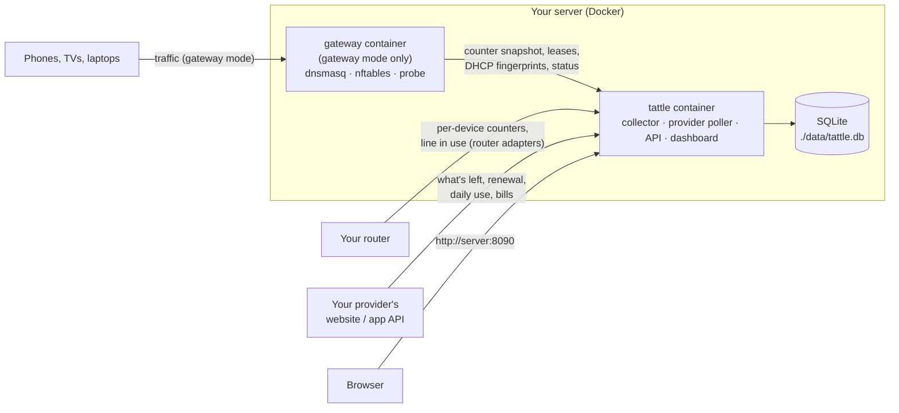

# How Tattle is built

## The pieces

- **`tattle`** (always runs, unprivileged, read-only filesystem): a Python service (FastAPI + SQLite) that serves the dashboard (React, built into the image) and runs two background threads:
  - the **collector** (`backend/tattle/collector.py`) books traffic per device per hour: from the gateway's counters every 10 s in gateway mode, or from a router adapter every minute or so in router mode. Every 10 minutes it also links a phone's different private Wi-Fi addresses into one device (`identity.py`);
  - the **provider poller** (`backend/tattle/isp.py`) reads every connected provider account every 15 minutes through its plugin (`backend/tattle/providers/`).
- **`gateway`** (gateway mode only, `NET_ADMIN`): makes the server the network's DHCP server and gateway. It runs dnsmasq, loads an nftables table that forwards and masquerades the house's traffic while counting bytes per device IP, keeps Docker's firewall from dropping forwarded packets, watches for other DHCP servers and IPv6 router adverts, and writes what the app needs to files in shared volumes (`backend/tattle/gateway/`, see [gateway-mode.md](gateway-mode.md)).

The app never needs root: everything privileged lives in the gateway container, and they only share files.

## Counting modes

| Mode | Where counts come from | Device identity |
| --- | --- | --- |
| Quota only | none; the provider's figures only | — |
| Router | a router adapter's per-MAC running totals (`backend/tattle/routers/`) | MAC (+ hostname the router knows) |
| Gateway | nftables counters per LAN IP, booked on whoever holds the IP at that moment | DHCP client ID, else MAC, else IP; DHCP fingerprints and Bonjour names help link private addresses |

The collector picks the mode on its own each tick: gateway when the gateway's snapshot is fresh, router when a router adapter with per-device counters is configured, otherwise quota-only. `TATTLE_MODE` in `.env` says what the installer set up, so a stopped gateway shows up in the health panel instead of silently becoming quota-only.

## Data

One SQLite file, `./data/tattle.db`:

- `devices`, `usage_hourly` (bytes per device per hour), `device_sessions` (when each device was sending), `device_names`, `merge_suggestions`, `identity_events`: the devices and their use. Usage stays recorded per identity, so a merge of two identities can always be undone.
- `provider_accounts` (sign-ins; credentials are the plugin's JSON), `isp_lines`, `isp_readings` (every reading, every 15 minutes), `isp_daily` (the provider's daily history), `line_switches` (when the house changed lines).
- `settings`, `counter_state` (last raw counter values, so restarts lose nothing), `wan_hourly` (the router's own counters next to Tattle's).

## The quota cycle

The cycle comes from the provider: from the date the line's plan last renewed (or the start date the provider gives) to the renewal date it shows now, for the line the house is on. A typed renewal day is only used when no provider is connected. Right after a renewal, before the provider shows the new date, the cycle rolls forward a month and is marked *pending*.

## Plugins

- Providers: one file in `backend/tattle/providers/`, a `Provider` subclass. See [adding-a-provider.md](adding-a-provider.md).
- Routers: one file in `backend/tattle/routers/`, a `RouterAdapter` subclass. See [adding-a-router.md](adding-a-router.md).

A broken plugin is logged and skipped; it never takes the dashboard down.
