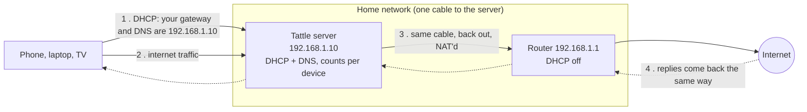

# Gateway mode

In gateway mode the Tattle server becomes your network's DHCP server and
default gateway. Every device's internet traffic passes through it, so it can
count each device exactly, on any router, without the router's help.

It needs no new hardware and no rewiring: the server stays plugged into the
router (or a switch) with one Ethernet cable, next to the router rather than
between it and the internet.

- [How it works](#how-it-works)
- [Requirements](#requirements)
- [Setting it up](#setting-it-up)
- [Wi-Fi extenders](#wi-fi-extenders)
- [IPv6](#ipv6)
- [When the server goes down](#when-the-server-goes-down)
- [Firewalls](#firewalls)
- [Docker live-restore](#docker-live-restore)
- [Settings](#settings)
- [Turning it off](#turning-it-off)
- [Troubleshooting](#troubleshooting)

## How it works



1. **DHCP.** Tattle's dnsmasq hands out addresses and names the server as each
   device's gateway and DNS server. The router's own DHCP is switched off; the
   router stays as the second DNS server, so names keep resolving if the server
   is down.
2. **Forwarding.** A device sends its internet traffic to the server, which
   passes it on to the router over the same interface it arrived on (a
   "one-armed" router).
3. **NAT.** On the way out the server masquerades the traffic, so the router
   sends the replies back to the server instead of straight to the device.
   That is what lets Tattle count downloads, not just uploads.
4. **Counting.** An nftables table (`inet tattle`) keeps a byte counter per
   device IP in each direction, plus one for the server's own traffic. It only
   counts what was really forwarded (it runs after every other firewall on the
   server). The dashboard reads a snapshot of it every few seconds and books the
   bytes on whichever device holds that address at the time.

Traffic between devices at home (casting to the TV, copying files) goes device
to device and is never counted. It doesn't touch the internet line, so it
doesn't use your quota.

The kernel would normally tell devices to skip the server and talk to the
router directly (an ICMP "redirect"), because both are on the same network.
Tattle's table drops those redirects.

Two containers run from the same image. The dashboard runs without any
privileges. The `gateway` container is root inside, but with only the network
capabilities a router needs (`NET_ADMIN`, `NET_RAW`, `NET_BIND_SERVICE`). They
share nothing but a few files, which the dashboard mounts read-only:

| File | What it is |
| --- | --- |
| `/run/tattle/nft.json` | The counters (`nft -j list table inet tattle`), every 5 s |
| `/run/tattle/gateway.json` | The gateway's health, every 30 s: the checks below, forwarding, other DHCP servers, IPv6 adverts |
| `/var/lib/tattle/dnsmasq.leases` | Who holds which address |
| `/var/lib/tattle/dhcp/<mac>.json` | Each device's DHCP request "shape", used to tell an iPhone from an Android phone |

**Restarts and upgrades don't cut the internet.** When the gateway container
stops, it leaves the forwarding rules in place: devices keep routing through
the server on the leases they have (2 hours), and get a new one as soon as the
container is back. The rules carry a fingerprint of what they contain. A
restart or an upgrade that produces the same rules leaves the live table alone,
so no counter is reset.

## Requirements

- **Wired Ethernet.** All the house's traffic crosses the server's link twice
  (in and back out). Wi-Fi can't keep up, and many Wi-Fi drivers drop forwarded
  traffic anyway.
- **A fixed address for the server.** Once the router's DHCP is off, a server
  that got its own address by DHCP would lose it. The installer offers to make
  the current address fixed (NetworkManager, netplan or dhcpcd), or tells you
  how.
- **A router whose DHCP server you can turn off.** Nearly all can.
- **Linux 5.10 or newer** (any distribution from 2021 on), on amd64 or arm64
  (a Raspberry Pi needs the 64-bit OS), with **rootful Docker** from
  [get.docker.com](https://get.docker.com). Rootless Docker, Docker from Snap and
  Podman can't change the host's network, and the gateway refuses to start on
  them.
- **Nothing else answering DHCP or DNS on the server**: no Pi-hole, AdGuard
  Home or other dnsmasq on the same machine.

An old laptop makes a good server: it has Ethernet, and its battery keeps the
house online through short power cuts.

## Setting it up

The installer does all of this and asks before each change:

```bash
curl -fsSL https://raw.githubusercontent.com/khaledsharara/tattle/main/install.sh | bash
```

Choose **3) Gateway**. It then:

1. makes the server's address fixed, if it is a DHCP lease;
2. turns on IP forwarding for good (`/etc/sysctl.d/90-tattle.conf`);
3. opens DHCP, DNS, the dashboard and forwarding in firewalld or ufw, if one is active;
4. makes sure the iptables lock file exists at boot (`/etc/tmpfiles.d/tattle-xtables.conf`);
5. offers Docker's [live-restore](#docker-live-restore);
6. picks the addresses to hand out: the longest free run near the top of your
   network, skipping the router, the server and anything that answers right now;
7. starts the dashboard and the gateway.

Then, on any router:

1. **Turn off the router's DHCP server.** Open its settings page (often
   `http://192.168.1.1`). The switch is usually under *LAN*, *Network*,
   *LAN setup* or *DHCP server*. Leave everything else as it is: the router
   keeps its address and stays the way to the internet.
2. **Turn off IPv6 on the LAN**, if the router has the option (see [IPv6](#ipv6)).
3. **Set each Wi-Fi extender's or mesh point's DHCP server to Off** (see
   [Wi-Fi extenders](#wi-fi-extenders)).
4. **Reconnect devices**: turn Wi-Fi off and on, or unplug and replug a cable.
   Devices you don't touch move over by themselves when their old lease runs out.

Devices appear under **Devices** as they reconnect. The health panel on the
Overview turns green once only Tattle hands out addresses and traffic is
passing through.

Until you turn the router's DHCP off, both hand out addresses. That's harmless
for a few minutes, but the health panel keeps saying another DHCP server is
answering until you do.

Devices you gave a fixed address and gateway by hand (some printers, NAS boxes,
cameras) keep using the router directly and aren't counted. Set them to
automatic (DHCP), or set their gateway to the server's address.

## Wi-Fi extenders

Range extenders such as TP-Link's RE series do **MAC-NAT**. On the network,
every device behind the extender appears with the extender's own hardware
address. That breaks any counting based on MAC addresses, including the router's
own. Gateway mode copes:

- **Identity from the DHCP client ID.** Each device puts its own identifier in
  its DHCP requests (usually its real MAC), and the extender passes that through
  untouched. Tattle tells devices apart by it, and counts by IP address, which
  every device has its own of.
- **Broadcast replies.** Extenders that translate MAC addresses often lose DHCP
  replies sent straight to a device's own address. Tattle always broadcasts its
  replies (`dhcp-broadcast`).
- **Set the extender's DHCP server to Off, not Auto.** On *Auto* an extender
  starts its own DHCP server whenever it stops hearing the router's. With the
  router's DHCP off, that is all the time, and it hands out wrong gateways.
  Tattle probes the network every ~10 minutes and the health panel names any
  other DHCP server that answers.
- **Give extenders a fixed address** in their own settings (outside Tattle's
  range), so their admin pages stay where you left them and they don't depend
  on the server to come up.

## IPv6

Tattle counts **IPv4** only. If the router announces IPv6 (router
advertisements, SLAAC or DHCPv6), devices get IPv6 addresses and can send
traffic straight to the router over IPv6, past Tattle. The gateway sends a
Router Solicitation every ~10 minutes, and the health panel says if a router
answers.

- **Best:** turn off IPv6 on the router's LAN side (sometimes called *IPv6 LAN*,
  *RA*, *SLAAC* or *DHCPv6 server*). The internet still works over IPv4.
- **If you can't:** set `TATTLE_FILTER_AAAA=1` in `.env`. Tattle's DNS then
  hides IPv6 addresses, so devices connect over IPv4 to anything they look up by
  name. Apps that use IPv6 addresses directly can still go around Tattle.

## When the server goes down

With gateway mode on, the house's internet goes through the server, so a dead
server (unplugged, crashed, out of battery) means no internet until it's back.
Restarts and upgrades of Tattle itself don't count: forwarding stays on while
the container restarts.

**Recovering takes two minutes:**

1. On a phone, connect to the router's settings page. If the phone has no
   address any more, set one by hand in its Wi-Fi settings: an address outside
   Tattle's range (e.g. `192.168.1.250`), mask `255.255.255.0`, router
   `192.168.1.1`.
2. Turn the router's DHCP server back on.
3. Turn Wi-Fi off and on, on each device. They now get their address from the
   router, as before Tattle.

Devices you don't touch switch back on their own: Tattle's leases last 2 hours,
and when one runs out the device asks again and the router answers.

When the server is back, turn the router's DHCP off again and reconnect
devices (or wait, as before). The gateway picks up where it left off, and usage
for the time it was down is simply missing.

## Firewalls

The gateway adds no port firewall of its own and changes nothing in other
tables. Three things on a server can get in its way:

- **Docker** (iptables mode) sets the `FORWARD` policy to `DROP`. The gateway
  inserts one rule into Docker's `DOCKER-USER` chain that accepts traffic in and
  out of the LAN interface, tagged `tattle-gateway`. Docker wipes it when it
  restarts, so the gateway checks every minute and puts it back. It works out
  whether Docker uses iptables-nft or iptables-legacy by looking at which one
  holds Docker's chains. With Docker's nftables firewall
  (`"firewall-backend": "nftables"`, Docker 29+) nothing needs opening, but
  Docker no longer turns IP forwarding on; the installer does.
- **firewalld** (Fedora, RHEL, openSUSE): the zone of the LAN interface has to
  allow DHCP, DNS, the dashboard's port and forwarding within the zone. The
  installer runs, for you:

  ```bash
  sudo firewall-cmd --permanent --zone=<zone> --add-service=dhcp --add-service=dns \
       --add-port=8090/tcp --add-forward
  sudo firewall-cmd --reload
  ```

  `--add-forward` needs firewalld 1.0 or newer.
- **ufw** (Ubuntu): its forward policy drops everything by default. The
  installer adds:

  ```bash
  sudo ufw allow in on eth0 to any port 67 proto udp
  sudo ufw allow in on eth0 to any port 53
  sudo ufw allow 8090/tcp
  sudo ufw route allow in on eth0 out on eth0
  ```

The gateway checks for itself whether something drops forwarded traffic. It
counts devices' internet packets twice: before every other firewall, and after
them all. If they reach the first count but not the second, the health panel
says another firewall is dropping them.

`systemctl restart nftables` on Debian and Ubuntu flushes the whole ruleset,
Tattle's table included. The gateway notices within a minute and loads it
again. The counters restart from zero, and the dashboard handles that.

## Docker live-restore

Normally, when Docker itself restarts (an upgrade of the docker package, for
example), it stops every container, including the gateway's DHCP. The
forwarding rules stay, so devices keep working, but no new device can join
until the containers are back. With live-restore, containers keep running while
Docker restarts. The installer offers to add it to `/etc/docker/daemon.json`,
keeping whatever else is there:

```json
{ "live-restore": true }
```

and reloads Docker's settings (`systemctl reload docker`), which doesn't stop
running containers. It doesn't work together with Docker Swarm.

## Settings

All in `~/tattle/.env`; the installer detects and writes them. After a change:
`cd ~/tattle && docker compose --profile gateway up -d`.

| Setting | Default | What it is |
| --- | --- | --- |
| `TATTLE_LAN_IF` | the interface of the default route | The wired interface on the home network |
| `TATTLE_SERVER_IP` | that interface's address | This server's fixed address |
| `TATTLE_LAN` | from the address and its prefix | The home network, e.g. `192.168.1.0/24` |
| `TATTLE_ROUTER_IP` | the default route's gateway | The router |
| `TATTLE_DHCP_RANGE` | the longest free run in the top ~200 addresses | `first,last` addresses to hand out; keep the router, the server, extenders and fixed devices outside it |
| `TATTLE_DHCP_LEASE` | `2h` | How long a lease lasts (also how long devices take to move back to the router on their own) |
| `TATTLE_DNS` | the router | Where Tattle's DNS forwards lookups; comma-separated for several |
| `TATTLE_FILTER_AAAA` | `0` | `1` hides IPv6 addresses in DNS answers (see [IPv6](#ipv6)) |
| `TATTLE_LOCAL_NAME` | `tattle.lan` | A name for the server on your network |
| `TATTLE_PROBE_INTERVAL` | `600` | Seconds between checks for other DHCP servers and IPv6 routers |
| `TATTLE_SKIP_ROUTE_CHECK` | `0` | `1` skips the "internet route" check (for test setups only) |

Useful commands, from `~/tattle`:

| | |
| --- | --- |
| Health and checks | `docker compose exec gateway python -m tattle.gateway status` |
| Logs | `docker compose logs -f gateway` |
| The rules and dnsmasq config it would use | `docker compose run --rm gateway render` |
| Check for other DHCP servers now | `docker compose kill -s USR1 gateway` |
| Who holds which address | `docker compose exec tattle cat /var/lib/tattle/dnsmasq.leases` |

## Turning it off

```bash
cd ~/tattle
docker compose --profile gateway rm -sf gateway   # stop the gateway first, or it puts its rules back
docker compose run --rm gateway off               # remove the table and the Docker rule
```

Then turn the router's DHCP back on and reconnect devices (or wait up to 2
hours). Re-running the installer and picking another mode does all of this for
you, and `install.sh --uninstall` removes Tattle entirely (keeping your data
unless you add `--purge`).

## Troubleshooting

The gateway refuses to start while one of its checks fails. It writes the reason
to its log and to the dashboard's health panel, and tries again on its own,
so fixing the cause is enough.

| It says | What to do |
| --- | --- |
| *IP forwarding is off, so this server can't pass devices' traffic on...* | Run the command it gives: `echo 'net.ipv4.ip_forward=1' \| sudo tee /etc/sysctl.d/90-tattle.conf && sudo sysctl -p /etc/sysctl.d/90-tattle.conf`. Usual with Docker's nftables firewall, which doesn't turn forwarding on. |
| *This server got 192.168.1.10 from the router's DHCP...* | Make the address fixed: re-run the installer, or set it as a manual address in the network settings (same address, the router as gateway and DNS). |
| *This server reaches the internet through wlan0, not through eth0...* | Two connections are up (often Wi-Fi and a cable on a laptop). Turn the other one off, or set `TATTLE_LAN_IF` and `TATTLE_ROUTER_IP` to the one that leads to the router. |
| *Another DHCP server already runs on this server (UDP port 67 is taken...)* | Pi-hole, AdGuard Home, another dnsmasq, isc-dhcp-server or a NetworkManager "shared" connection. Turn its DHCP off, or use another mode. (libvirt's dnsmasq on `virbr0` is fine; it shares the port.) |
| *Something else on this server already answers DNS on 192.168.1.10 port 53...* | A DNS server listening on every address: Pi-hole, AdGuard Home, dnsmasq, bind... Turn it off or limit it to other addresses. systemd-resolved (127.0.0.53) is fine. |
| *This container runs in a user namespace (rootless Docker...)* / *...installed from Snap* / *...under Podman* | Install regular Docker from [get.docker.com](https://get.docker.com) and run the installer again. |
| *This server's Linux kernel (...) is too old...* | Update the operating system; Linux 5.10 or newer is needed. |
| *Couldn't load Tattle's firewall rules: ...* | Usually a kernel without nftables NAT. Check `docker compose logs gateway` for nft's own message. |
| *TATTLE_DHCP_RANGE ... includes this server / the router* | Change the range in `.env` so it leaves both out. |
| *Another firewall on this server (firewalld, ufw or Docker) is dropping devices' internet traffic...* | See [Firewalls](#firewalls), or re-run the installer, which opens what's needed. |
| *Couldn't update Docker's firewall (...)* | Usually `/run/xtables.lock` is missing or a folder: `docker compose --profile gateway rm -sf gateway; sudo rmdir /run/xtables.lock; sudo touch /run/xtables.lock`, then start the gateway again. The installer's tmpfiles entry keeps it from coming back. |
| *Another DHCP server is handing out addresses on this network: 192.168.1.1 (00:00:5e:00:53:01)...* | The router's DHCP is still on, or an extender's DHCP is on *Auto*. Turn it off (*Off*, not *Auto*). The address and hardware address say which box it is. |
| *A router announces IPv6...* | Turn off IPv6 on the router's LAN, or set `TATTLE_FILTER_AAAA=1` ([IPv6](#ipv6)). |
| *IPv6 is turned off on this server, so Tattle can't check...* | Informational. If the router hands out IPv6 to devices, that traffic isn't counted. |
| *No device has an address from Tattle yet* | The router's DHCP is still on, or devices haven't renewed. Turn it off, then reconnect a phone's Wi-Fi. |
| The house has no internet | See [When the server goes down](#when-the-server-goes-down). |

More: [troubleshooting.md](troubleshooting.md) (the whole health panel) and
[architecture.md](architecture.md).
